# Goblin Game Engine

**The goal: a living, breathing alternative world that anybody can explore and make their own.**

The Goblin Game Engine is a Godot 4 engine and toolchain for building very large, inhabited, procedurally generated
worlds, and for building them with AI agents. Every part of the world comes from research and from tools that can be
rerun:
- generators for terrain, towns and floating cities;
- modular building, vehicle and character pipelines;
- a living population with daily lives;
- offline checkers that can see and test all the geometry without launching the game.

Its sample game, **Space Station Columbia**, is that world.

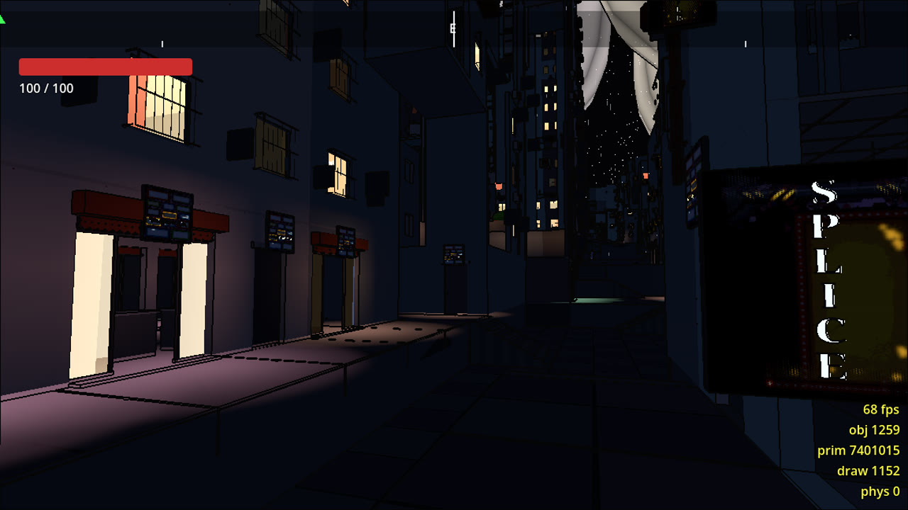

## Space Station Columbia

An ark ship 500 years into a 1,500-year voyage: an O'Neill cylinder 20 km across and 22.4 km long, launched in 2252.
The game year is 2752. Its floor holds a research-derived American landscape at full scale:
- 22 towns and cities; the cities are self-contained city-states, each with its own customs, diplomacy and sphere
  of influence;
- farms, rivers, a lake, two seas, roads and a railway;
- a rocky New England north, a sandy California south, and river towns that blend the two.

The Sunline, travelling the central Spindle, lights it. You can walk it, drive its electric vehicles, ride its road
trams or fly its aerostats. The menu is the NYNEX Communicator, a mid-90s PDA running "The System".

750 m overhead drift **the Skein**: 100 floating cities, home to 97,070 Aloft islanders across 44 architectural
traditions. They are the world's mixing engine. An island's people and its architecture often come from different
heritages (Black Anglo families in a Maghrebi medina, Irish-Scots in a Scots close town), and new customs grow out
of the blend. The islands dock into rafts, trail 300 m banners advertising their names and wares, fly their own
flags, and come down to trade.

Where they come down is the **flea markets**: every town keeps a weekend market with a mooring ground beside it.
Islands book a stay, descend to 600 m, drop their crews by cage, rig trading tents and run gondolas you can ride.
Five moored islands make a Bright Week of lights; seven at a small town shut the shops for a Sky Holiday.

| | |
|---|---|
| 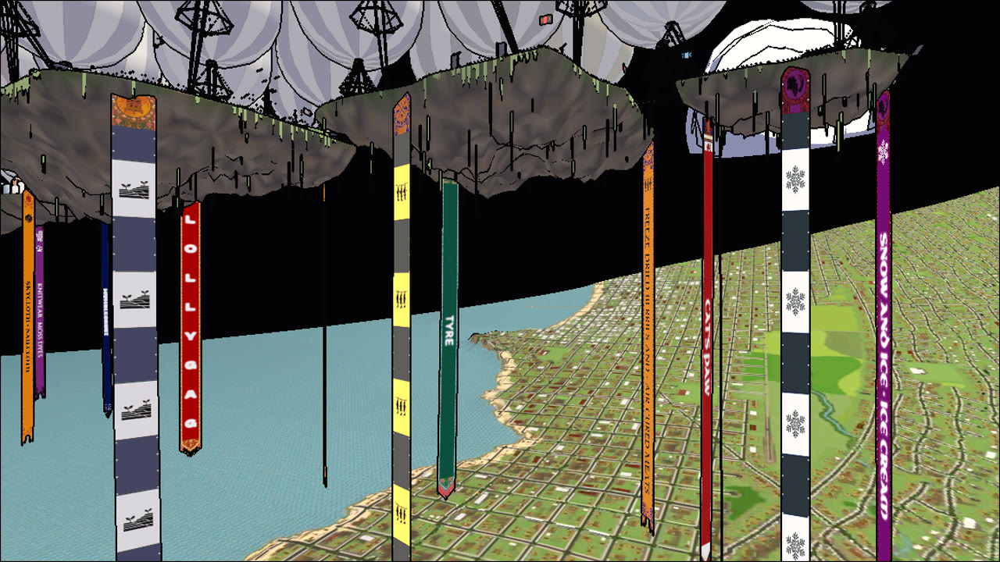 | 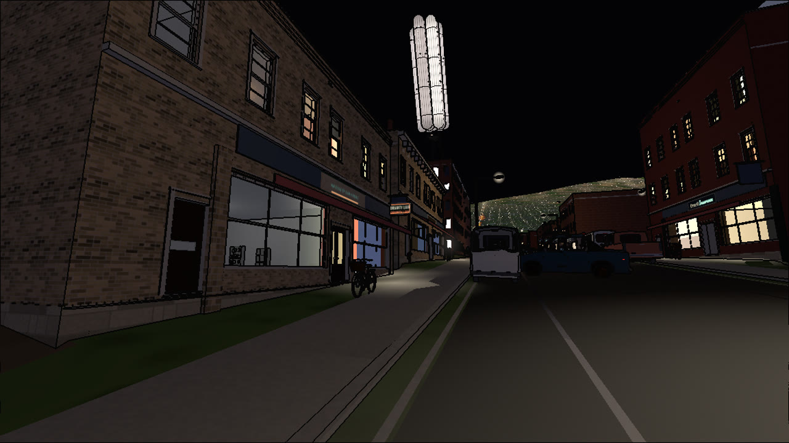 |
| Island banners from below: each island's name and wares | Calder at night: bitmap shop signs and lamp pools |
| 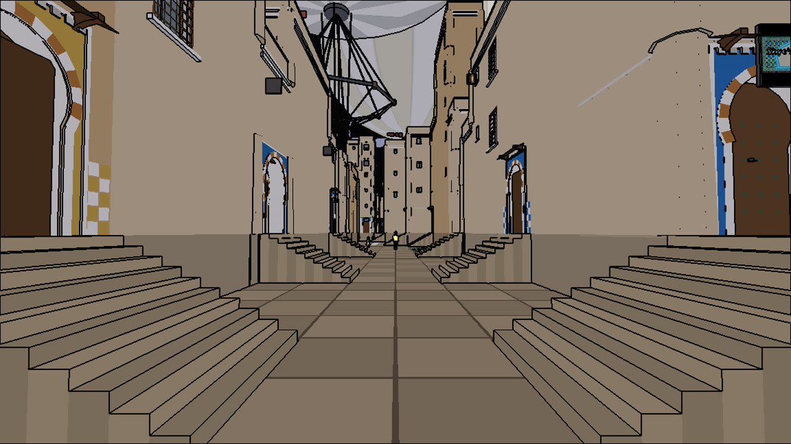 | 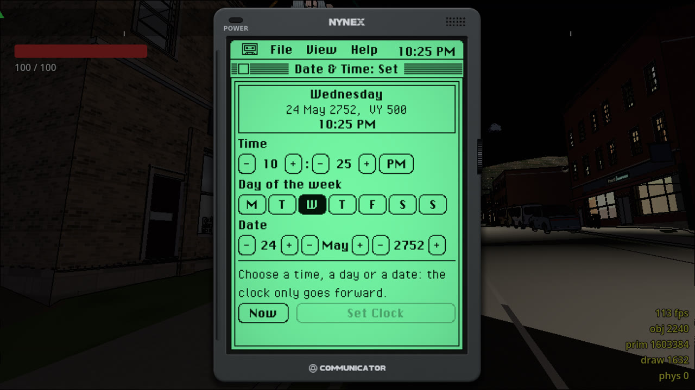 |
| A medina lane on a floating city | The Communicator's new Date & Time app |

### What's new (2026-10-16, second update: the flea markets)
- **A flea market in every town — all 22, 2,660 stalls.** Gravel lots with striped bays and lamp poles, covered shed
  rows, open rows with fire lanes, food truck courts, entrance arches, lettered market boards and pylon signs, each
  fitted to its town's free land by a siting search. Victory Bay had no free land, so **The Regatta Swap floats on a
  pier over the water**.
- **A real market week.** Markets run Friday to Sunday with setup, lantern-lit evenings and teardown. 21,280
  townsfolk hold stalls as a weekend second job, drawn from the real population; hundreds of out-of-town shoppers
  drive in on market days.
- **The islands come down to trade.** Every floating city got a mooring quarter: 191 gondola stations, 255 line
  houses, 88 crew davits, joined to the island walk nets. Islands book stays on a pure weekly calendar, descend to
  600 m, drop crews, rig tents and hawsers, and cast off again; rafts lash together and banners furl. Gondolas are
  rideable jig-back cabins at 8 m/s, and winds over 9 m/s hold everything.
- **Bright Weeks and Sky Holidays.** Five islands in service light the whole lot; seven at a small town shut the
  shops (Loomis Grove: 91 of 105 units), ring the market with islander tents and fill the town with a holiday fair.
- **From across the ring** the market lots now show by day and glow by night (the far side rebaked, 400 tiles day
  and night).
- Under the hood: the whole sky-drift step with moorings costs 2.8 ms (was 15), two generator regressions the
  offline audit caught are fixed, and a bake-stamp bug that silently rebuilt roads on every load is gone.

| | |
|---|---|
| 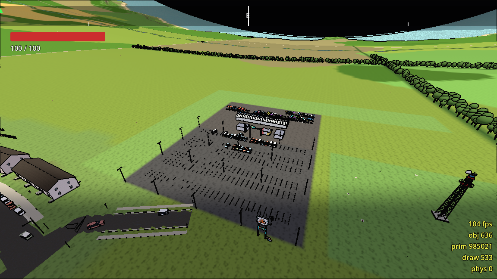 | 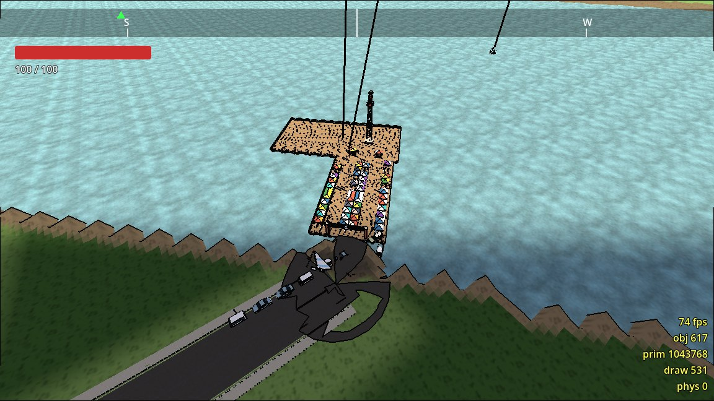 |
| Calder's market on a market Friday | The Regatta Swap: Victory Bay's market floats on a pier |
| 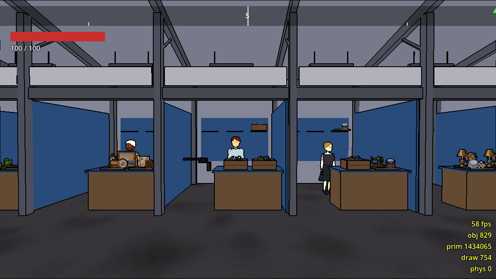 | 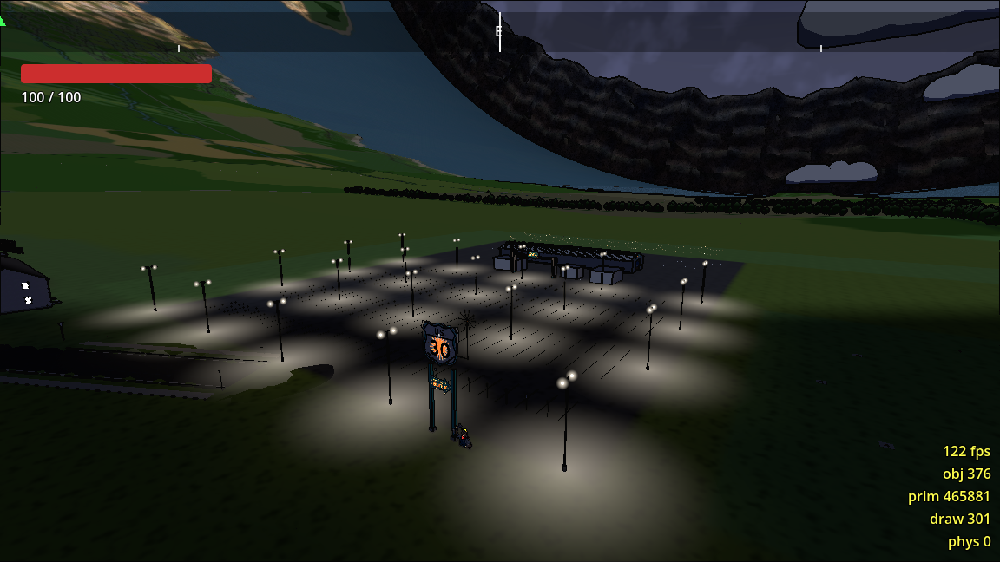 |
| A shed aisle at Solana Point | Calder's lot after dark: lamp poles and festoons |
| 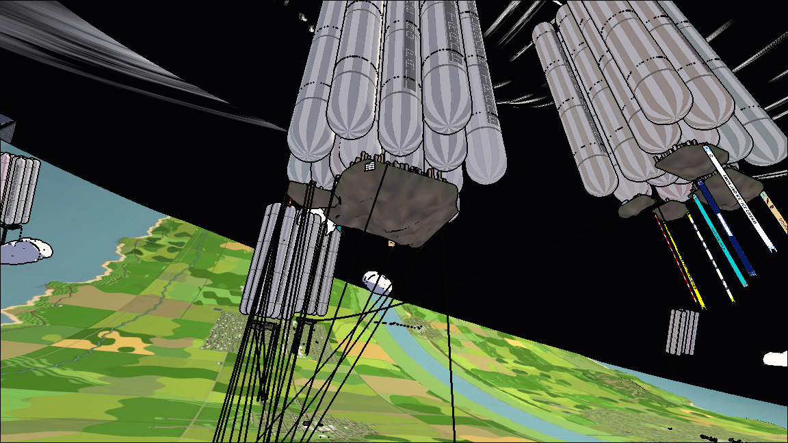 | 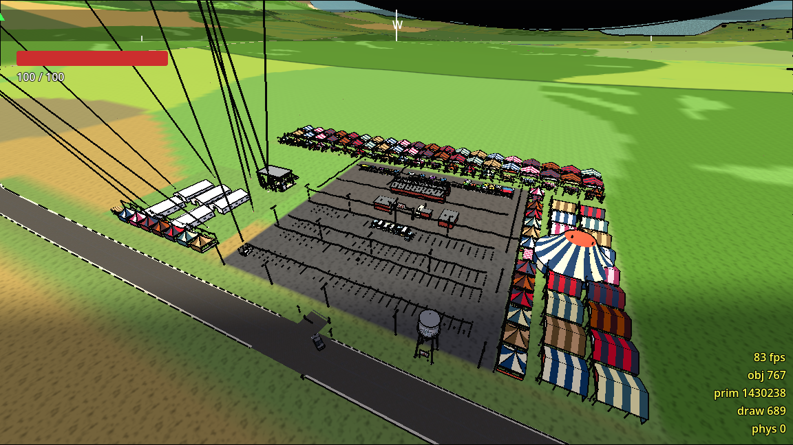 |
| A host island moored at 600 m over its market | A Sky Holiday: islander tents ring Loomis Grove's market |

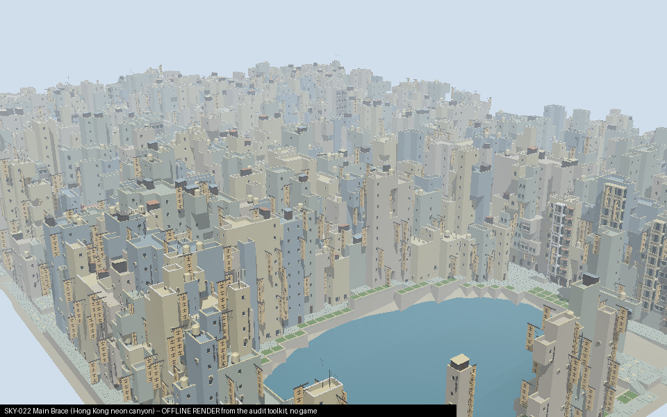
*Offline render of SKY-022 from the audit toolkit, with no game running. The same morning's update made all 100
floating cities walkable door to door — see [CHANGELOG.md](CHANGELOG.md).*

## The tools that build it

Each tool is a script you can rerun. The world is regenerated, not hand-placed.

| Tool | What it does |
|---|---|
| `tools/map_expanded.py`, `road_network.py`, `road_fix.py`, `terrain_relief.py` | The map: terrain, rivers, seas and graded roads built to a researched road standard |
| `tools/settlegen/` | Towns and cities at 1:1: lots, centres, buildings, populations, jobs |
| `tools/sky/warren/` | The floating-city generator: it grows each island on a 3 × 3 × 3.2 m lattice in epochs, then a walk network, doors, paths, chunks and LODs |
| `remake/blender/sky/warren_kit/` | The 402-piece warren kit, plus its middle-detail versions, ramp and frame collision, and its own flicker and bounds checks |
| **`tools/sky/warren/audit/`** | **The offline geometry audit.** It assembles an island exactly as the game builds it (render and collision), then checks for holes, cracks, non-manifold and bad-normal meshes, z-fighting, floating pieces, pieces outside their bounds, and intrusions. Its walk simulation sweeps the player's capsule along every route to every door. It is verified by 11/11 mutation tests and against in-game walks, and renders offline views |
| `tools/markets/` | The flea markets: the 22 markets as numbers, a layout planner (lots, sheds, rows, moorings), a siting search over each town's free land, vendor pools from the real population, and `check_markets.py` |
| `remake/blender/markets/` | The 162-piece market kit (sheds, tents, signs, gondola cabins, ropeway gear), built in pure Python like the warren kit, with its own audit |
| `tools/sky/warren/moorings.py` | Mooring quarters on every island: station sites, walks, plinths and signal masts, surveyed across all 100 islands |
| `tools/signs/` | Sign sheets from 2D reference art, cut into atlases. It also renders each shop's real name in its region's style |
| `tools/bible/` | The game bible: canon for the world, its people, history and the islands, generated into `remake/bible` |
| `.claude/skills/ssc-asset`, `tools/assets/` | The asset pipeline. Grok makes 2D reference images only; every model is built in Blender from them, reproducibly |
| `tools/gcmd.py` and `DevBridge.gd` | Agent tooling: drive and inspect the running game from a shell |
| `Prof` / `PerfProbe` | Per-system frame profiling (60 fps on a Steam Deck is the budget; lessons in `research/perf_learnings.md`) |

`research/` holds the research everything is built from: urban layout, buildings, roads and traffic law,
demographics, daily lives, the sky islands, flea markets and bazaars, and more.

## Download

Earlier builds are on the [Releases](https://github.com/GoblinGameEngine/space-station-columbia/releases) page of
the old game repo. The latest is [0.7.9 alpha 2](https://github.com/GoblinGameEngine/space-station-columbia/releases/tag/v0.7.9-alpha.2):
- **Windows (x86_64):** `SpaceStationColumbia-windows.zip`. Unzip it, keep the `.pck` beside the `.exe`, and run
  `SpaceStationColumbia.exe`. It's unsigned, so SmartScreen may warn you: choose More info, then Run anyway.

To build the current version from source:
1. Run `python3 tools/pack_data.py`.
2. Export from `godot_project/` with Godot 4.7: `godot4 --headless --path . --export-release Linux build/space-station-columbia.x86_64`.

The game data pack is now about 3 GB.

You need a Vulkan-capable graphics card. The NPCs talk through Groq: paste your own free key in the Communicator's
NPC AI app.

**Testing?** Please report bugs and impressions on the [Issues](https://github.com/GoblinGameEngine/goblin-engine/issues)
page. Say what you were doing, what you expected and what happened; include your graphics card and a screenshot if
you can.

## Controls

Keyboard and mouse, or a controller: any gamepad, or the built-in controls of the Steam Deck, ROG Ally, Legion Go
and similar handhelds.

| | Keyboard / mouse | Controller |
|---|---|---|
| Move / look | WASD / mouse | left stick / right stick |
| Jump (swim up) / swim down | Space / Ctrl | A / B |
| Use, talk, board, leave a vehicle | E | X |
| Attack / change weapon | left click / wheel | RT / LB, RB |
| Sprint | hold Shift | click the left stick (stays on until you stop) |
| Communicator | Tab | Menu |
| Drive: throttle / brake, reverse / steer | W / S / A, D | RT / LT / left stick |
| Aerostat: climb / descend | Space / Ctrl | RT or A / LT or B |

**Getting around:**
- The Communicator's Summon menus bring aerostats, boats, cars, trucks, farm vehicles, small vehicles and trains to
  you.
- Fast travel lists the towns and the Floating Cities.
- Crashes count: a hit at 10 km/h or more is loud, and from 15 km/h it does damage.

In the Communicator, a controller moves a stylus: A taps, B goes back, LB and RB change tabs, the right stick scrolls
and Y opens the System menu. On a Steam Deck the touchscreen works too. Stick speed and invert-look are in Control
Panel > Controls.

**Handhelds:**
- **Steam Deck:** add the game to Steam with *Add a Non-Steam Game* and play it in Game Mode. Steam's on-screen
  keyboard comes up for text boxes.
- **ROG Ally and Legion Go:** run it on Windows as it is. The controls work as a gamepad, and Windows' touch keyboard
  comes up for text boxes.

## Roadmap

In this order:
1. **A player body:** a full body with a head (never seen from inside), crouch, ledge hang and climb, and modern
   first-person movement. The same animations drive every human NPC.
2. **The ship-blocker pass:** every clipping, non-manifold and bad-normal problem found and fixed project-wide, with
   the audit grown into a general geometry toolkit.
3. **Animals:** the ark's larger land mammals, wild and domestic, 500 years on.
4. **Trams:** a bigger tram network inside every town and city, with stops on the maps and as fast-travel points.
5. Then the city-states' politics, the story, and shipping.

Done: ~~the flea markets~~ (this update), ~~walkable floating cities, night light, signs~~ (0.8.2-beta.1).

## License

All rights reserved for now (see `LICENSE`). This repo is public so it's visible and testable, not because it's open
source yet. A permissive license is planned once the project reaches a usable state.

## Version

**Current: `0.8.2-beta.2`** (beta). It is tracked in the `VERSION` file at the repo root and mirrored into
`godot_project/project.godot`'s `config/version`. The change history is in [CHANGELOG.md](CHANGELOG.md).

The scheme is `MAJOR.MINOR.PATCH-phase.N`, where the phase is one of `prealpha`, `alpha`, `beta` or `rc`. The phase is
dropped at `1.0.0`, the first real release.
- `MAJOR.MINOR.PATCH` bumps like normal SemVer.
- `N` counts tagged pushes within a phase.
- Advancing a phase resets `N` to 1 and is a deliberate call. The project moved to alpha at 0.7.9 (2026-09-29) and to
  beta at 0.8.1 (2026-10-09).

Each versioned push is tagged as `v<version>`.

## Repo layout

- `godot_project/`: the Godot 4.7 project. The main scene is `remake/scenes/RemakeStation.tscn`.
  - `remake/` holds the station's data (terrain, placement, roads, vehicles), buildings, the sky islands and warrens,
    signs, and the bible.
  - `scripts/world/` holds the world systems: MapTerrain, MapRoads, DaySkySystem, StationCalendar, LightField,
    StreetLights and the rest.
- `remake/`: the building and kit pipelines (catalog records, Blender generators, checks).
- `tools/`: the generators, the audit and sign tools, and `gcmd.py` (the DevBridge client).
- `research/`: the research behind the map, the buildings, the road standard, the people, the islands and the
  markets.
- `docs/media/<date>/`: the screenshots for each update.

`.gitignore` excludes, on purpose:
- `/reference/`: source photos and reference images, kept local;
- `godot_project/.godot/`: the editor cache;
- `godot_project/build/`: export outputs;
- Blender autosaves and generated build products.

Pushed with the `gh` CLI as the `GoblinGameEngine` account. Commits use
`GoblinGameEngine <GoblinGameEngine@users.noreply.github.com>`, set locally for this repo.
